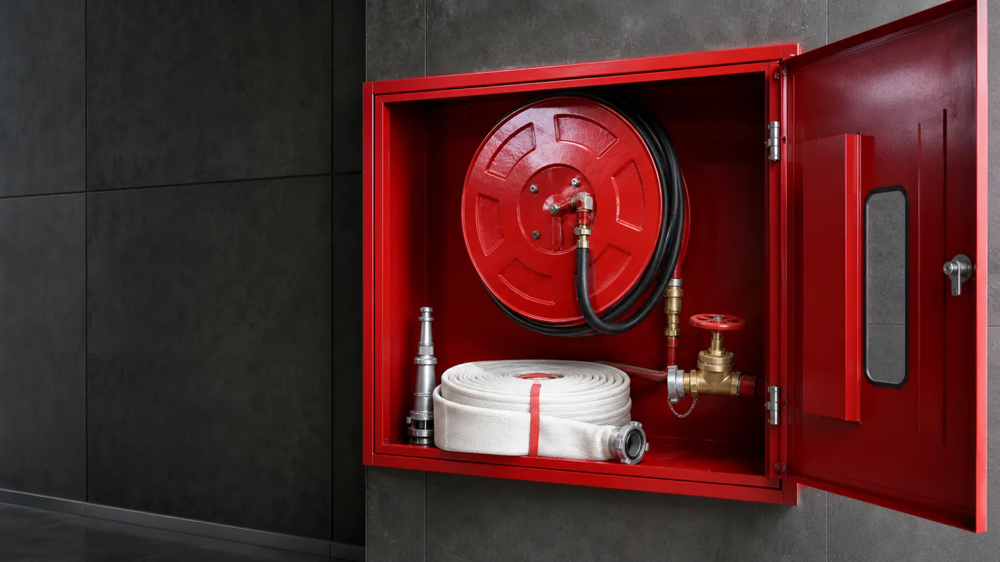
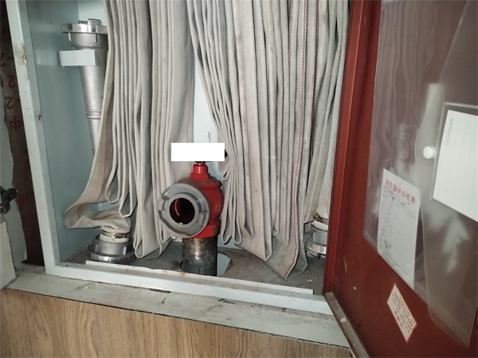
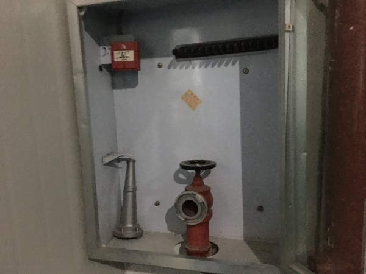
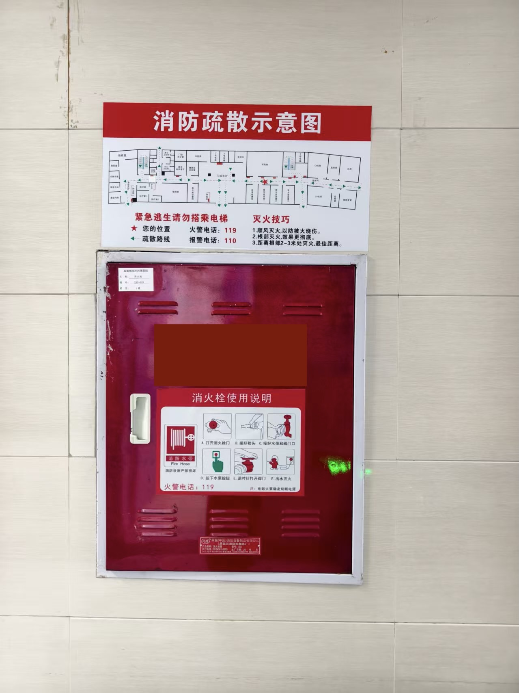
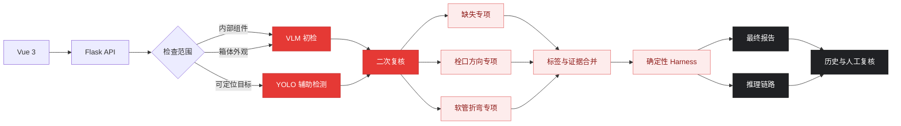

<p align="center">
  
</p>

<h1 align="center">XFDemo</h1>

<p align="center">
  <strong>让每一个 AI 结论，都能回到图像证据。</strong>
</p>

<p align="center">
  Evidence-first multimodal fire-safety inspection<br />
  VLM · YOLO · Specialist Review · Deterministic Harness · Human Feedback
</p>

<p align="center">
  <a href="https://github.com/Chan-Developer/XFDemo/stargazers">
    
  </a>
  <a href="https://github.com/Chan-Developer/XFDemo/network/members">
    
  </a>
  <a href="https://github.com/Chan-Developer/XFDemo/issues">
    
  </a>
</p>

<p align="center">
  
  
  
  
  
</p>

<p align="center">
  <a href="#-30-秒看懂-xfdemo"><strong>30 秒看懂</strong></a>
  ·
  <a href="#-推理架构"><strong>推理架构</strong></a>
  ·
  <a href="#-快速开始"><strong>快速开始</strong></a>
  ·
  <a href="https://github.com/Chan-Developer/XFDemo/issues"><strong>参与共建</strong></a>
</p>

---

> **XFDemo 不是又一个 VLM Prompt Wrapper。**
>
> 它是一条面向真实视觉巡检的证据链：模型负责观察，YOLO 负责定位，专项复核负责质疑，确定性规则负责守住边界，人工复核负责持续纠错。

## 30 秒看懂 XFDemo

<table>
  <tr>
    <td align="center"><strong>01 · SEE</strong></td>
    <td align="center"><strong>02 · LOCATE</strong></td>
    <td align="center"><strong>03 · VERIFY</strong></td>
    <td align="center"><strong>04 · GUARD</strong></td>
    <td align="center"><strong>05 · TRACE</strong></td>
  </tr>
  <tr>
    <td align="center">VLM 理解全图语义</td>
    <td align="center">YOLO 定位可见组件</td>
    <td align="center">专项模型复核争议项</td>
    <td align="center">规则阻止无证据结论</td>
    <td align="center">保存链路并支持人工纠错</td>
  </tr>
</table>

```text
一张巡检图
   │
   ├── VLM：看到了什么？整体是否异常？
   ├── YOLO：哪些组件真的可见？分别在哪里？
   ├── Specialist Review：缺失、方向、折弯是否成立？
   ├── Harness：标签和证据是否一致？范围有没有串用？
   └── Report：只输出最终成立的异常与对应证据
```

## 为什么值得关注

单次 VLM 输出在真实巡检中很容易遇到这些问题：

| 常见问题 | XFDemo 的处理方式 |
| --- | --- |
| 首轮识别到了异常，后续复核却把它覆盖 | 专项复核只拥有自己负责的标签，不允许清空其他证据 |
| YOLO 没检出组件，系统就断言“组件缺失” | YOLO 只提供辅助候选框，未检出不能单独证明缺失 |
| 透明箱门同时显示外观和内部，模型范围串用 | 先做检查范围对齐，再调用对应检测链路 |
| 自然弧度被误判为软管严重折弯 | 使用折弯专项证据门槛和反例约束 |
| 报告结论与正文证据互相矛盾 | 按“最终标签 → 对应证据”重新构建报告 |
| 线上误判无法定位是哪个环节造成的 | 保存阶段耗时、状态、模型摘要和 YOLO 可视化 |

## 产品能力

<table>
  <tr>
    <td width="33%" align="center">
      <br />
      <strong>组件级定位</strong><br />
      <sub>YOLO 检测框与 VLM 语义互相校验</sub>
    </td>
    <td width="33%" align="center">
      <br />
      <strong>缺失类专项复核</strong><br />
      <sub>水枪、水带等高误判标签独立验证</sub>
    </td>
    <td width="33%" align="center">
      <br />
      <strong>外观与标识识别</strong><br />
      <sub>内部组件和箱体外观使用独立范围</sub>
    </td>
  </tr>
</table>

### 不只是一个检测页面

- **智能检测**：上传图片，生成带证据的结构化检测报告。
- **检测历史**：查看原图、YOLO 可视化、最终标签和完整推理链路。
- **人工复核**：确认或修正模型结论，记录问题来源和复核依据。
- **数据集看板**：浏览严格清洗版本、标签、Prompt 版本和数据拆分。
- **多模态检索演示**：展示以图搜图、以文搜图和以图搜文的交互链路。
- **法规库与知识图谱演示**：为后续可验证法规引用和关系检索预留产品形态。
- **型材计数**：独立 YOLO 服务演示多任务接入方式。

## 推理架构



### Harness 到底做了什么

1. **检查范围对齐**
   区分内部组件、箱体外观和双范围可见，避免内部模型与外观模型串用。

2. **标签别名归一化**
   将模型产生的同义表达映射到标准标签，减少 Prompt 变化造成的标签漂移。

3. **证据门控**
   缺失、方向、折弯等高风险标签必须满足各自的可见证据条件。

4. **专项结果隔离**
   每个专项只能修改自己负责的标签，不能覆盖其他阶段已经成立的异常。

5. **冲突消解**
   组件明确可见时阻止“未检出即缺失”；视角或证据不足时返回无法判断。

6. **报告重建**
   最终报告按照“最终标签 → 对应证据”生成，确保结论、标签和正文一致。

## 技术栈

| Layer | Stack |
| --- | --- |
| Web | Vue 3 · Vite · Vue Router · Lucide |
| API | Flask · Python |
| Vision | OpenAI-compatible / Anthropic-compatible VLM API |
| Detection | Ultralytics YOLO |
| Orchestration | Staged Pipeline · Specialist Review · Rule Harness |
| Observability | JSONL History · Stage Trace · YOLO Visualization |
| Deployment | Docker · Nginx · Gunicorn |

## 快速开始

### 1. 获取代码

```bash
git clone https://github.com/Chan-Developer/XFDemo.git
cd XFDemo
```

### 2. 启动后端

推荐使用 Python 3.11。

```bash
python -m venv .venv
source .venv/bin/activate
pip install -r requirements-backend.txt
```

在项目根目录创建 `.env`，至少配置一个兼容 OpenAI API 的视觉模型：

```dotenv
FIRST_VL_PROVIDER=openai
FIRST_VL_API_BASE=https://your-vlm-endpoint.example/v1
FIRST_VL_API_KEY=your-api-key
FIRST_VL_MODEL=your-vision-language-model

JUDGE_VL_PROVIDER=openai
JUDGE_VL_API_BASE=https://your-vlm-endpoint.example/v1
JUDGE_VL_API_KEY=your-api-key
JUDGE_VL_MODEL=your-judge-model
```

尚未准备 YOLO 权重时，可以先使用纯 VLM 模式：

```dotenv
YOLO_ENABLED=0
```

```bash
python -m backend.app
curl http://127.0.0.1:5000/health
```

### 3. 启动前端

推荐使用 Node.js 18 或更高版本。

```bash
cd frontend
npm ci
npm run dev
```

访问 `http://127.0.0.1:3000`。Vite 会把 `/api` 请求代理到 `http://127.0.0.1:5000`。

<details>
<summary><strong>启用 YOLO 辅助检测</strong></summary>

<br />

仓库不包含模型权重。准备内部组件和外观模型后，在 `.env` 中配置：

```dotenv
YOLO_ENABLED=1
YOLO_PYTHON=/path/to/yolo/python
YOLO_INTERNAL_WEIGHTS=/path/to/fire_hydrant_internal.pt
YOLO_APPEARANCE_WEIGHTS=/path/to/fire_hydrant_appearance.pt
YOLO_CLASSES_FILE=/path/to/classes.json
YOLO_DEVICE=0
YOLO_CONF=0.20
```

YOLO 是辅助证据源，检测框不会直接决定最终合规结论。

### 统一 64 类检测

统一模式使用同一权重一次推理，再按模型自带的类别名称分配证据，不复用旧模型的数字类别编号：

```dotenv
YOLO_MODE=unified
YOLO_UNIFIED_WEIGHTS=/path/to/components_unified_64class_yolov8s_1280/weights/best.pt
YOLO_UNIFIED_IMGSZ=1280
YOLO_DEVICE=1
```

链路：原图 → 64 类组件定位 → 原图主体确认 → VLM 结合名称、坐标和原图生成报告。
室内消火栓、室外消火栓、灭火器保留各自复核流程；其他已接入设施仅生成组件观察描述，
结论显示“未开展合规判定”。识别到组件不代表组件正常，未检出也不代表缺失。
前端及历史记录保存完整候选框；给原三类报告的组件证据按分支隔离。

`scripts/backend/validate_unified.py` 可运行独立测试图片的真实链路回归；
通过 `VALIDATION_OUTPUT` 指定 JSON 结果文件，`VALIDATION_BRANCHES` 指定逗号分隔的分支。
设置 `VALIDATION_PUBLIC_URL` 和 `VALIDATION_SOURCE` 后，可验证公网登录、流式检测、历史及图片接口；
仅创建临时测试账号，并清理本次生成的测试记录。回归结果不是全类别准确率评估。
上线前检查 `/health` 的 `release` 和 `detector_mode`。回滚需恢复同一发布版本的代码、环境配置和前端镜像，
不要改动模型权重、数据库或用户历史。配置 `YOLO_MODE=legacy` 可恢复旧检测分支。

发布记录（2026-11-16）：业务代码 `d17b29f`，发布分支 `codex/unified-yolo-release-20261116`。
阿里云运行前端 Docker 镜像 `xf-frontend:release-d17b29f`，通过 Tailscale 访问 L40 的 Flask 5000 端口。
L40 使用 GPU 1 运行统一 YOLO；SGLang 按 `sglang/config_2.yaml` 在 GPU 2、3 提供
`Qwen3-VL-32B-Instruct`（9300，服务名 `XF-VLM`）；复核仍使用原云端 `qwen3-vl-plus`，没有替换复核模型。
统一权重为 `components_unified_64class_yolov8s_1280/weights/best.pt`，
SHA256：`e55b09a2785535e1acc898f5227f6520e2991288c2dd55550f5d64ba2881add7`。

- 28 项自动化测试、前端构建、1440px 桌面和 390px 手机报告布局检查通过；布局检查使用模拟报告，不替代实图验证。
- 正式模型组合的 11 张场景图首次 10/11 通过分支和单次 YOLO 检查；水泵接合器误分为室外消火栓，补充结构与设备名称证据后单独复测通过。原三类又单独完成最终分类提示词的路由复测。
- 原先的防火门/喷头分支不一致已在本轮实图中修正；室内样例的栓口方向误报未再次出现。
- 闭门样例实际进入箱体外观。首次范围断言因中英文范围名比较失败；修正测试后重验保存结果通过，原失败日志未覆盖。
- 公网灭火器、防火门、水泵接合器 3/3 端到端用例通过：登录会话、流式报告、分支、历史原图/标注图、修订读取及新类别状态均已检查。耗时分别约 46、137、343 秒。首次测试的大图上传等待不足，调整测试脚本后重测通过；早期失败日志保留，临时测试账号与记录在结束后清理。

这些结果是接入回归，不是 64 类全量准确率或合规能力验收。新增设施仍只输出观察描述，
不作合格/不合格判定，不转录铭牌中的细小参数。单图耗时波动较大，本轮约 18–356 秒，
不能承诺实时检测。原三类既有业务判定标准仍需单独与人工标准持续对齐。
测试原始结果保存在 L40 候选目录 `runtime/results/unified_production_review.json`、
`unified_connector_retest.json`、`unified_route_retest.json`、`unified_closed_review.json`；
公网结果位于正式目录 `runtime/results/unified_public_review.json`。
后端回滚包：正式目录 `runtime/releases/before-unified-20261116.tar.gz`（含私有配置，不提交 Git）；
阿里云保留旧容器 `xf-frontend-before-unified-20261116` 和镜像 `xf-frontend:release-29a67cd`。

</details>

## 项目结构

```text
XFDemo/
├── backend/
│   ├── api/                         # Flask 路由
│   ├── config/                      # 环境与路径配置
│   ├── infrastructure/              # VLM、YOLO、型材计数客户端
│   └── modules/
│       ├── inspection/              # Prompt、复核、规则与报告生成
│       ├── history/                 # 检测历史与人工复核
│       └── dataset/                 # 数据集查询服务
├── frontend/                        # Vue 3 + Vite
├── services/pipes_counting/         # 型材计数推理服务
├── tools/
│   ├── data_pipeline/               # 数据处理与统计
│   ├── training/qwen25vl/           # 多模态微调数据构建
│   └── research/vision_attention/   # 离线研究工具
├── resources/                       # 参考图与演示样例
├── scripts/                         # 启动、推理和部署脚本
├── deploy/                          # Docker 与 Nginx 配置
├── archive/legacy/                  # 历史实现，仅供追溯
├── artifacts/                       # 模型与导出物，不提交 Git
├── output/                          # 离线任务产物，不提交 Git
└── runtime/                         # 在线运行产物，不提交 Git
```

## 能力边界

模型权重、训练数据、API Key、检测历史、日志和运行产物不会提交到仓库。你需要使用自己的模型服务、权重和数据完成部署。

法规库、多模态检索和知识图谱当前包含演示能力，不应直接用于真实执法、正式合规认定或其他高风险决策。

## Roadmap

- [ ] 固定人工标注回归集与端到端评测脚本
- [ ] 检测历史迁移到结构化数据库
- [ ] 组件级置信度校准和跨模型冲突统计
- [ ] 法规知识库的可验证引用与版本管理
- [ ] 可复现的 Docker Compose 开发环境
- [ ] 英文界面与英文文档

## 一起把它做得更可靠

欢迎通过 [Issues](https://github.com/Chan-Developer/XFDemo/issues) 分享误判样例、Prompt 设计、YOLO 数据集、评测方法或工程建议。

提交问题时，请尽量包含：

- 脱敏后的原始图片
- 期望结论和可见证据
- 实际输出与推理链路
- 使用的模型、配置和复现步骤

<p align="center">
  <a href="https://github.com/Chan-Developer/XFDemo/stargazers">
    
  </a>
</p>

<p align="center">
  <sub>Built for traceable multimodal inspection.</sub>
</p>
