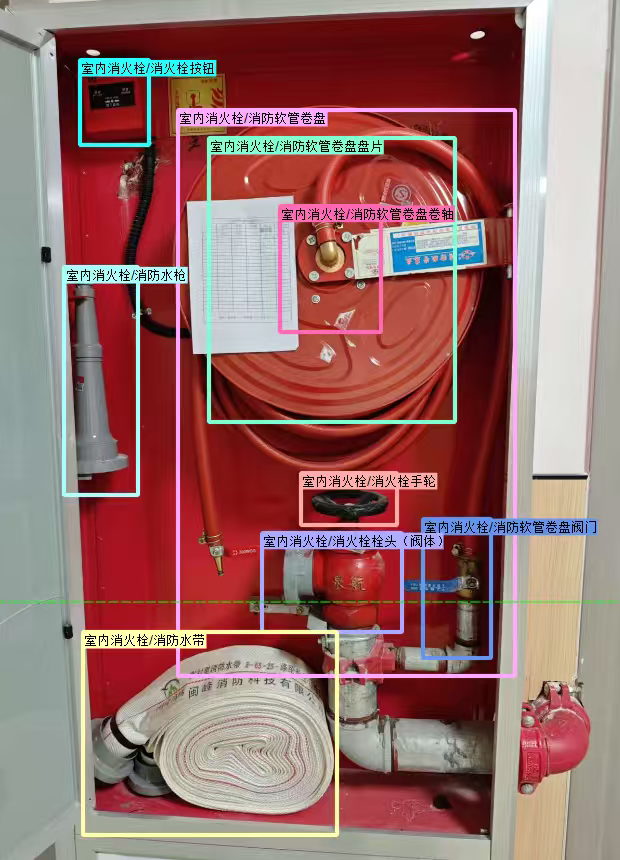
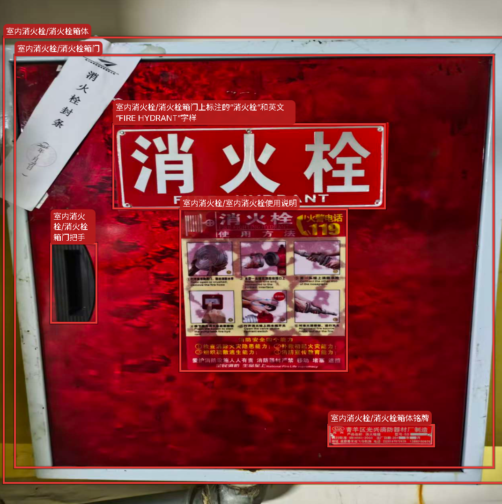
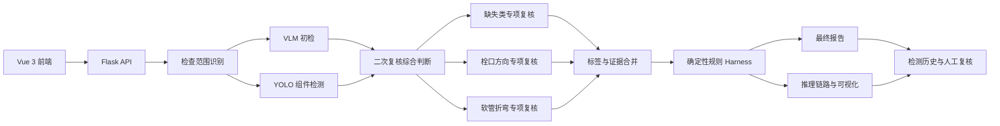

# XFDemo

<p align="center">
  <strong>面向消防设施巡检的可追溯多模态 AI 系统</strong><br />
  Vision-Language Model + YOLO + 专项复核 + 确定性规则
</p>

<p align="center">
  <a href="https://github.com/Chan-Developer/XFDemo/stargazers">
    
  </a>
  <a href="https://github.com/Chan-Developer/XFDemo/network/members">
    
  </a>
  <a href="https://github.com/Chan-Developer/XFDemo/issues">
    
  </a>
  
  
  
</p>

<p align="center">
  XFDemo 不是一次简单的“看图问答”。它把视觉模型、目标检测、专项复核和规则后处理组织成一条可监控、可解释、可人工纠正的消防巡检链路。
</p>

<p align="center">
  <a href="#快速开始"><strong>快速开始</strong></a>
  ·
  <a href="#推理架构"><strong>查看架构</strong></a>
  ·
  <a href="https://github.com/Chan-Developer/XFDemo/issues"><strong>提交问题</strong></a>
  ·
  <a href="https://github.com/Chan-Developer/XFDemo/stargazers"><strong>Star 项目</strong></a>
</p>

---

## 为什么做 XFDemo

消防巡检图片经常同时包含视角偏差、组件遮挡、透明箱门、相似部件和缺失类隐患。单次 VLM 输出容易出现三类问题：

- **看见了但没保留**：首轮模型识别到异常，后续复核覆盖了其他标签或证据。
- **没检出就当缺失**：YOLO 没有召回某个组件，被错误推断为组件缺失。
- **结论与证据脱节**：报告写着“不合规”，正文却没有能够支撑该结论的可见证据。

XFDemo 的核心目标，是让每一个最终标签都能回到对应证据，并让每个模型阶段都可以被追踪、复核和纠正。

## 项目亮点

| 能力 | 说明 |
| --- | --- |
| VLM + YOLO 协同 | VLM 负责整体语义判断，YOLO 提供内部组件或箱体外观的可定位候选框 |
| 专项复核 | 对水枪/水带缺失、栓口方向、软管严重折弯等高误判问题独立复核 |
| 证据保留 | 专项复核只修改自己负责的标签，不能覆盖其他异常的证据 |
| 确定性 Harness | 检查范围对齐、标签归一化、证据门控、冲突消解和最终一致性校验 |
| 全链路追踪 | 保存各阶段耗时、状态、关键输出、YOLO 可视化和最终报告 |
| 人工复核 | 历史记录支持人工确认、修正结论、问题归因和复核说明 |
| 数据集看板 | 浏览清洗后的图像、标签、Prompt 版本、训练/验证拆分和样例记录 |

## 界面与检测对象

<table>
  <tr>
    <td align="center"><strong>内部组件参考</strong></td>
    <td align="center"><strong>箱体外观参考</strong></td>
  </tr>
  <tr>
    <td></td>
    <td></td>
  </tr>
</table>

当前前端包含智能检测、检测历史、人工复核、数据集看板、法规库演示、多模态检索演示、知识图谱和型材计数等页面。模型权重和业务数据不会提交到仓库。

## 推理架构



### Harness 做了什么

1. **检查范围对齐**：先区分内部组件、箱体外观或双范围可见，避免内部模型与外观模型串用。
2. **标签别名归一化**：把模型输出中的同义表达映射到标准标签，减少标签漂移。
3. **证据门控**：缺失、方向、折弯等高风险标签必须满足各自的可见证据条件。
4. **专项结果隔离**：每个专项只拥有自己负责的标签，不能清空其他阶段已经成立的异常。
5. **冲突消解**：组件明确可见时，阻止“未检出即缺失”；证据不足时返回无法判断。
6. **报告重建**：最终报告按照“最终标签 -> 对应证据”重新生成，避免结论和正文互相矛盾。

## 技术栈

| 层级 | 技术 |
| --- | --- |
| Web | Vue 3、Vite、Vue Router、Lucide |
| API | Flask、Python |
| 视觉理解 | OpenAI-compatible / Anthropic-compatible VLM API |
| 目标检测 | Ultralytics YOLO |
| 推理编排 | 分阶段 Pipeline、专项复核、规则后处理 |
| 运行数据 | JSONL 历史记录、结果文件、YOLO 可视化 |
| 部署 | Docker、Nginx、Gunicorn |

## 快速开始

### 1. 获取代码

```bash
git clone https://github.com/Chan-Developer/XFDemo.git
cd XFDemo
```

### 2. 启动后端

推荐使用 Python 3.11。

```bash
python -m venv .venv
source .venv/bin/activate
pip install -r requirements-backend.txt
```

在项目根目录创建 `.env`，至少配置一个兼容 OpenAI API 的视觉模型：

```dotenv
FIRST_VL_PROVIDER=openai
FIRST_VL_API_BASE=https://your-vlm-endpoint.example/v1
FIRST_VL_API_KEY=your-api-key
FIRST_VL_MODEL=your-vision-language-model

JUDGE_VL_PROVIDER=openai
JUDGE_VL_API_BASE=https://your-vlm-endpoint.example/v1
JUDGE_VL_API_KEY=your-api-key
JUDGE_VL_MODEL=your-judge-model
```

没有准备 YOLO 权重时，可以先关闭 YOLO：

```dotenv
YOLO_ENABLED=0
```

启动 Flask：

```bash
python -m backend.app
```

健康检查：

```bash
curl http://127.0.0.1:5000/health
```

### 3. 启动前端

推荐使用 Node.js 18 或更高版本。

```bash
cd frontend
npm ci
npm run dev
```

浏览器访问 `http://127.0.0.1:3000`。开发服务器会把 `/api` 请求代理到 `http://127.0.0.1:5000`。

## 启用 YOLO

仓库不包含模型权重。准备好内部组件和外观模型后，在 `.env` 中配置：

```dotenv
YOLO_ENABLED=1
YOLO_PYTHON=/path/to/yolo/python
YOLO_INTERNAL_WEIGHTS=/path/to/fire_hydrant_internal.pt
YOLO_APPEARANCE_WEIGHTS=/path/to/fire_hydrant_appearance.pt
YOLO_CLASSES_FILE=/path/to/classes.json
YOLO_DEVICE=0
YOLO_CONF=0.20
```

YOLO 在本项目中是**辅助证据源**，检测框不会直接决定最终合规结论。缺少检测框也不能单独证明组件缺失。

## 项目结构

```text
XFDemo/
├── backend/
│   ├── api/                         # Flask 路由
│   ├── config/                      # 环境与路径配置
│   ├── infrastructure/              # VLM、YOLO、型材计数客户端
│   └── modules/
│       ├── inspection/              # Prompt、复核、规则与报告生成
│       ├── history/                 # 检测历史与人工复核
│       └── dataset/                 # 数据集查询服务
├── frontend/                        # Vue 3 + Vite
├── services/pipes_counting/         # 型材计数推理服务
├── data_pipeline/                   # 数据处理与统计
├── finetune_qwen25vl/               # 多模态微调数据构建
├── resources/references/            # 合规参考图
├── scripts/                         # 启动、推理和部署脚本
├── deploy/                          # Docker 与 Nginx 配置
└── runtime/                         # 运行产物，不提交 Git
```

## 数据与模型边界

为避免泄露业务数据和产生超大仓库，下列内容默认不提交：

- 消防巡检原图与训练数据集
- VLM、YOLO 和型材计数模型权重
- API Key、服务器地址和本地 `.env`
- 检测历史、日志、临时文件和可视化结果
- Python 虚拟环境、Node 依赖和 Docker 镜像

你需要使用自己的模型服务、权重和数据完成部署。

## 当前状态

XFDemo 正在持续迭代，适合用于：

- 学习多模态模型与目标检测的工程协同方式
- 研究“模型输出 + 专项复核 + 确定性规则”的可靠性设计
- 搭建可追溯、可人工复核的视觉巡检原型
- 复用数据集看板、检测历史和证据可视化组件

法规库、多模态检索和知识图谱目前包含演示能力，不应直接用于真实执法、合规认定或高风险决策。

## Roadmap

- [ ] 建立固定人工标注回归集和端到端评测脚本
- [ ] 将检测历史迁移到结构化数据库
- [ ] 增加组件级置信度校准和跨模型冲突统计
- [ ] 完善法规知识库的可验证引用与版本管理
- [ ] 提供可复现的 Docker Compose 开发环境
- [ ] 增加英文界面与英文文档

## 参与项目

欢迎提交 Issue 讨论误判样例、Prompt 设计、YOLO 数据集、评测方法和工程架构。提交问题时，请尽量提供：

- 脱敏后的原始图片
- 期望结论和可见证据
- 实际输出与推理链路
- 使用的模型、配置和复现步骤

如果 XFDemo 对你的多模态视觉项目有帮助，欢迎点击右上角 **Star**。Star 会帮助更多开发者发现这个项目，也会直接影响后续公开内容的优先级。

---

<p align="center">
  Built for traceable multimodal inspection.
</p>
